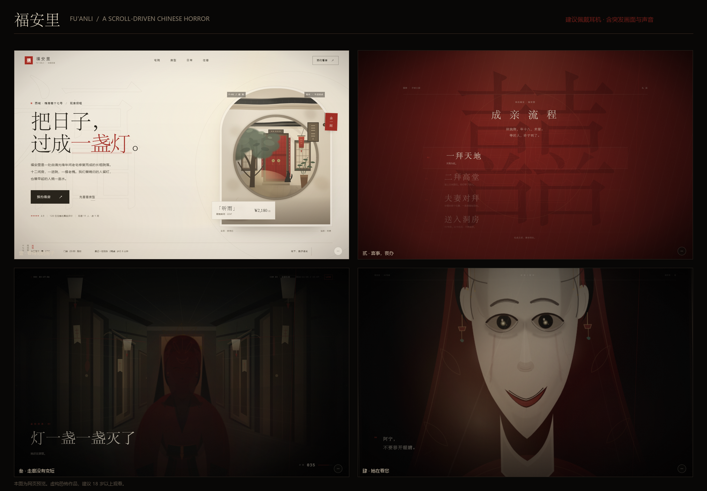

# 福安里 · FU'ANLI

> 一处由清光绪年间老宅修复而成的长租院落。十二间房，一进院，一棵老槐。
>
> 我们替晚归的人留灯，也替早起的人烧一壶水。

一个从**高端长租公寓营销页**缓慢坠入**中式冥婚、凶宅与头七**叙事的滚动恐怖网页。

**[在线体验 →](https://l-yuyou.github.io/fuanli/)**

> 推荐桌面浏览器、佩戴耳机、慢慢向下滚动。
> 页面含突发画面、闪烁与恐怖音效，建议 18 岁以上观看。

## 关于

前半段是一个完整的虚构长租网站：房型、公区、住客评价、预约表单都像真的。

从「入住流程」开始，红色纸面会从屏幕底部升起。往下是林宅旧事、走廊里的纸扎新娘、住客登记簿、03号房的规则，以及一场只差一个名字的婚礼。

表单中留下的称呼会在后面的住客名录、婚书与告别里出现；所有信息只在浏览器内存中，**不上传、不保存**。

## 交互提示

- 声音默认关闭，可通过页面右下角的波形按钮开启。
- 只想查看视觉、不想被突脸：在网址后加 `?safe=1`。
- 支持手机布局、键盘操作和 `prefers-reduced-motion`。
- 纯静态 HTML / CSS / JavaScript，无第三方依赖，无网络请求。

## 内容提醒

本页为虚构恐怖作品。福安里、林婉卿、何姨及所有事件均为虚构。

页面包含突发画面、闪烁与恐怖音效；建议 18 岁以上观看，请勿在深夜独自浏览；若感到不适，请立即关闭页面。

---

*房子会等。人也一样。*
